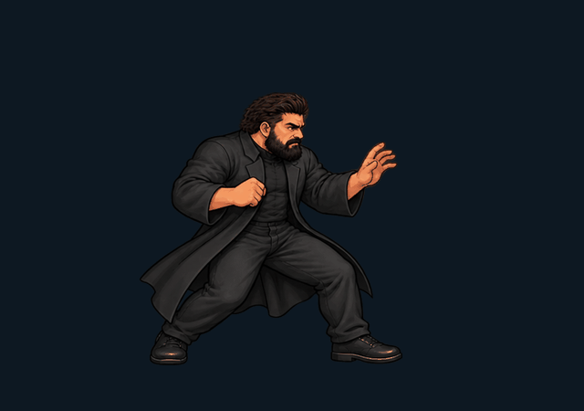

# Marcelo — piloto de arte 2D

Esta versão introduz 64 desenhos novos do Marcelo e a reprodução dessas poses no combate Godot. É o piloto da direção visual, não a renovação concluída dos 13 personagens.

## Ver em movimento

Abra o jogo e selecione **TESTAR MARCELO / NOVA ARTE**. A/D anda; W pula; S agacha; F soca; G chuta; S+F e S+G executam golpes baixos; H defende; T lança código; Y executa ascendente; Q cria sentinela; U invoca enxame com barra cheia.

**F3** alterna uma demonstração automática, enviando comandos pelo mesmo motor usado pelo jogador. **F4** compara a arte nova e a original sem alterar colisões, dano ou simulação. R reinicia e recarrega a barra no treinamento. Esc pausa; Enter continua; Esc novamente volta ao menu.



## Entrega visual

| Atlas | Desenhos | Uso |
|---|---:|---|
| punch | 8 | Guarda, preparação, extensão e recuperação do soco |
| walk | 8 | Passadas alternadas com movimento de quadril, tronco e braços |
| states | 16 | Guarda, defesa, salto, aterrissagem, impacto, dizzy, queda e vitória |
| combat | 16 | Chute, ascendente e preparação/emissão/recuperação de poder |
| low | 8 | Soco agachado e rasteira |
| air-kick (v2) | 8 | Preparação, extensão e retração de voadora, registrada pelo quadril |

Os originais gerados estão em `assets/source/marcelo-art-v1/`. Os atlases preparados estão em `assets/characters/marcelo/art-v1/`. `data/characters/marcelo-art-v1.json` registra recortes, origem nos pés e escala por atlas. O empacotador extrai os desenhos por componentes conexos e preserva seus pixels; ele não desenha poses intermediárias.

Preparação reprodutível (fora do runtime):

```bash
python -m pip install pillow numpy scipy
python tools/pack_pilot_art.py assets/source/marcelo-art-v1
```

O jogo seleciona os desenhos em `PilotArt` pela fase do golpe e tick autoritativo. A interpolação da posição no render é independente: não há morph automático entre rostos/membros nem esqueleto girando recortes. Poses-chave podem permanecer expostas por vários ticks. A simulação a 120 Hz não exige 120 desenhos diferentes por segundo.

## Impacto e poderes

`CombatImpact` consome eventos com IDs para faíscas, flash de contato, escurecimento de super e abalo visual. `SpriteFighterView` cria rastros a partir das próprias poses. Hitstop, hitstun e blockstun pertencem à simulação. `PowerView` desenha código animado, rotores/laser de drones e efeitos próprios por personagem; entidades de projétil têm ID, idade, delay e TTL restauráveis.

As vozes PT-BR anteriores foram preservadas. A nova arte de lutador é do Marcelo. Código, drones, fumaça, garfos e livros usam desenhos animados próprios sobre o elenco importado; os outros personagens ainda precisam do mesmo trabalho de redesenho e revisão de animação corporal.

## Limites e revisão

É uma primeira passagem de arte: exige revisão visual de continuidade, silhueta, apoio de pés e alcance. Não se afirma equivalência de qualidade com a produção da Capcom. As caixas importadas são a base de gameplay; F4 mantém as mesmas regras para permitir comparar a apresentação. O alinhamento fino de cada novo desenho com as caixas ainda é parte da revisão do personagem.

Há desenhos compartilhados entre forças e alguns golpes contextuais; isto não equivale a desenhar uma sequência independente para cada um dos 36 recursos do Marcelo. Agarrões e transições especiais ainda precisam de arte dedicada.

## Geração

Ferramenta: geração de imagens integrada, com referências locais do próprio personagem. Nenhuma arte de lutador da Capcom foi incorporada.

Prompt comum: “Production animation sprite atlas for Street Vicente Fighter. Preserve Marcelo's recognizable face, swept-back dark brown hair, full beard, stocky adult build, black long open coat, black shirt, trousers and boots, no glasses. Hand-drawn arcade 2D, strong ink outlines, three-tone cel shading. Fixed side/three-quarter camera facing right; consistent anatomy, scale and identity; full bodies and complete limbs; transparent background; no text, grid, scenery or baked-in effects.”

Variações aplicadas: punch — 8 chaves consecutivas de guarda/preparação/soco/recuperação; walk — 8 chaves de contato/apoio/passagem alternadas; states — 16 estados de defesa, salto, impacto e queda; combat — 8 chaves de chute, 4 de ascendente, 4 de emissão de poder; low — 4 chaves de soco agachado e 4 de rasteira. As referências e os arquivos originais permanecem versionados para revisão.


## Revisão 2 — voadora e poderes

A voadora passou a usar `assets/characters/marcelo/art-v2/air-kick.webp`, registrado em `data/characters/marcelo-air-v2.json` pela posição do quadril. Não reutiliza a guarda/chute terrestre. A origem física continua nos pés virtuais; o sprite não reinicia o arco do pulo. O contato com o chão encerra a hitbox e a animação aérea, limpa comandos aéreos pendentes e entra em Landing. `data/moves/marcelo_air_kick_v2.tres` define o alcance na altura do novo pé.

`assets/effects/powers-v1/powers.webp` contém 16 chaves: código (4), drone (4), fumaça (4), garfo (2), livro (2). O atlas e seu registro estão separados da física. Giz, raios, pinceladas e outros motivos continuam com apresentação procedural. O especial da Dienes usa giz; livros aparecem no super.

`PowerSystem` simula emissão na posição da mão, trajetórias, sentinelas fixas, formação do enxame, carregamento e lasers diagonais com colisão própria. O mesmo código é utilizado no Versus e no História. Dano no História não ocorre mais por uma área invisível instantânea. A renderização do História usa câmera e lane do mesmo mundo.

A preparação dos novos atlases pode ser reproduzida com `python tools/pack_combat_effects.py`. Os originais estão em `assets/source/marcelo-air-v2/` e `assets/source/powers-v1/`, excluídos do export. Geração integrada de imagens: prompt aéreo solicitou oito poses consecutivas da mesma voadora com quadril fixo e identidade/costume do Marcelo preservados; prompt de VFX solicitou quatro fases de onda digital, quatro de drone, quatro de vapor, duas de garfo e duas de livro, com transparência e separação entre células.

O teste Web exercita a voadora e a aterrissagem por teclado, verifica pixels verdes novos no lançamento de código, captura laser em voo, usa poderes no História e seleciona Gustavo/Khauãny/Dienes para registrar seus efeitos.

## Revisão 3 — contato Marcelo × Rafael

As caixas ofensivas passam a seguir o punho/bota de cada desenho ativo, pelo mesmo calendário de `FighterPose`. O exemplo `marcelo_air_kick_v2.tres` corresponde ao novo perfil; os dados canônicos por quadro ficam em `combat-profiles-v3.json`. A silhueta do Rafael substitui seus antigos retângulos largos; o ponto da faísca é a interseção real. O treino pausado mantém o palco visível para inspeção com F1.

A primeira versão do código usou 12 desenhos de carga, voo e impacto; a revisão 4 abaixo substitui a rajada e o impacto para recuperar a identidade do original. A faísca de contato tem sua própria sequência; não reutiliza o desenho do projétil. O atlas mecânico de drones continua preservado; entrada, flutuação, carga, mira, disparo, recuo e saída foram separados. O enxame usa formação em arco e disparos escalonados. O laser mantém um vestígio breve do canhão até o ponto atingido. Os novos efeitos são código nativo de apresentação e não novos desenhos corporais do personagem.

### Arquivo da primeira arte da rajada (substituída na revisão 4)

`assets/effects/marcelo-code-v3/code.webp` adiciona **12 desenhos de VFX**: quatro de concentração na mão, quatro de voo e quatro de impacto/dissipação. O desenho pintado fornece a silhueta; caracteres e rastros em GDScript complementam a cauda. `data/characters/marcelo-code-v3.json` registra recortes, pivôs e escalas. As colisões continuam independentes da opacidade da imagem.

Fonte transparente: `assets/source/marcelo-code-v3/code.png`. Ferramenta: geração integrada de imagens; o prompt integral está em `assets/source/marcelo-code-v3/PROMPT.md`. Preparação mecânica reproduzível: `python tools/pack_marcelo_code.py`. Os separadores seguem os gutters reais da imagem, preservando faíscas e partículas; não se inventam quadros intermediários. Os originais ficam excluídos do pacote Web.


## Revisão 4 — recuperar a base visual original

A rajada T volta ao motivo do jogo Canvas: núcleo com chaves, trilhas de circuito e pacotes binários, com luz suave, contorno e centro em cel shading. A chama pintada deixa de ser usada no voo/impacto de T. A carga do especial volta ao pequeno glifo retangular do original. `MarceloArcadeFX` porta essa apresentação para desenho nativo Godot; não executa o motor JavaScript. Os desenhos/mira/carga/laser dos drones Q/U foram preservados.

O gancho Y comprime no chão, passa dois frames de design no impulso e lança uma única vez. O calendário corporal acompanha velocidade vertical e contato com o chão: subida com punho erguido, ápice, queda e absorção na aterrissagem. Reutiliza os desenhos corporais existentes, sem alegar que foram criados quadros inéditos. A trilha do Firewall segue o punho registrado; o antigo círculo no tronco e o segundo clarão solto de emissão foram removidos. O alcance ativo continua registrado no próprio punho, sem dano na recuperação.

O teste Web captura separadamente subida/queda do gancho, rajada em voo, contato e drones. As capturas do jogo e o vídeo ficam no artefato `StreetVicente-Web-QA` da execução de Actions. Testes de colisão/replay validam comportamento; a comparação visual continua necessária para avaliar a arte.

Referência direta: `Street-Vicente-Fighter-`, commit `b320e497682bbfe0e2fc39883818183fa02521f5`, funções `drawEnergyProjectile`, `drawEnergyRise` (`src/fight-fx.js`) e `drawPowerGlyph` (`src/render.js`). O repositório original não foi alterado.
